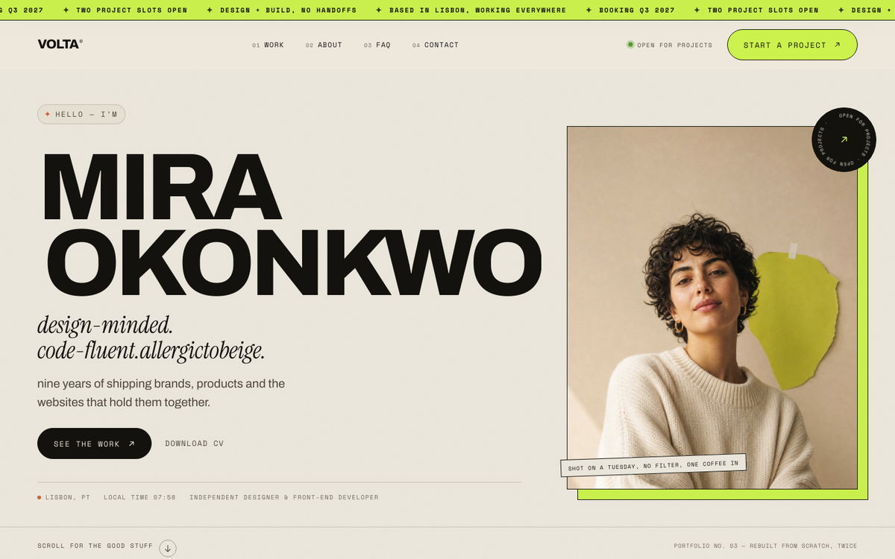

<!-- ═══════════════════════════════════════════════════════════════════════
     VOLTA — animated README. Every animation below is a public SVG service
     (capsule-render / readme-typing-svg / shields.io), so it renders on
     GitHub without shipping extra files.
     ═══════════════════════════════════════════════════════════════════════ -->

<div align="center">


<a href="https://github.com/">
  
</a>

<br />


<br /><br />


</div>

<div align="center">

### 🖼️ what it looks like



<sub><a href="preview-full.jpg">↕ open the <b>full-page</b> screenshot</a></sub>

</div>

<br />

<div align="center">
  
</div>

VOLTA is a one-page portfolio for designers, developers and creative generalists who would rather be **loud than beige**. It ships as a **fully static Next.js export** — no server, no database, no animation dependency — and deploys free on GitHub Pages, Vercel, Netlify or Cloudflare Pages.

Everything on the page comes from a single file: [`content/site.js`](content/site.js). Change your name, your projects and your FAQ there; the layout, motion and art direction stay intact.

<table>
<tr>
<td width="50%" valign="top">

**Built for**

- designers who code
- front-end devs with taste
- creative studios & duos
- anyone bored of template-y templates

</td>
<td width="50%" valign="top">

**Not built for**

- blogs or CMS-driven sites
- e-commerce
- 12-page corporate sites
- anyone who wants a page builder

</td>
</tr>
</table>

<div align="center">
  
</div>

| ✦                 | Detail                                                                                                                                                           |
| :---------------- | :--------------------------------------------------------------------------------------------------------------------------------------------------------------- |
| **10 sections**   | ticker · nav · hero · disciplines marquee · about & stats · selected work · FAQ accordion · contact · footer · mobile menu                                       |
| **Custom cursor** | dot + lagging ring, labelled disc over project cards, auto-inverts on dark sections, off for touch & reduced-motion users                                        |
| **Motion**        | masked line reveals, scroll-triggered fades, magnetic buttons, pointer parallax portrait, count-up stats, infinite marquees, clip-path menu, scroll progress bar |
| **Type**          | Archivo (display) · Instrument Serif (italic accent) · Space Mono (meta) — self-hosted at build time via `next/font`                                             |
| **Colour**        | bone `#EDE8DD` · ink `#14120E` · acid `#CBF24D` · clay `#D9603B`, all as CSS variables                                                                           |
| **Accessibility** | skip link, focus-visible rings, `aria-expanded` accordion & menu, keyboard-closeable overlay, full `prefers-reduced-motion` fallback                             |
| **Performance**   | ~110 kB first-load JS, no images requested by JS, zero third-party scripts, zero runtime CSS-in-JS                                                               |
| **Responsive**    | 390 px → 1920 px, fluid `clamp()` type scale, single-column mobile layout, distinct tablet breakpoint                                                            |

<div align="center">
  
</div>

```bash
# 1 — install
npm install

# 2 — run it hot
npm run dev          # → http://localhost:3000

# 3 — build the static site
npm run build        # → ./out

# 4 — look at the built site the way the internet will
npm run preview      # → http://localhost:3000
```

> **Node 18.18+** is required (Node 20 recommended). No other tooling, no global CLIs.

<div align="center">
  
</div>

<details open>
<summary><b>Click to fold / unfold the file tree</b></summary>

```text
volta-portfolio/
├── app/
│   ├── globals.css        ← design tokens, base layer, shared utilities
│   ├── layout.jsx         ← fonts, metadata, ticker + nav + footer
│   └── page.jsx           ← section order for the page
├── components/
│   ├── About.jsx          ← sticky label + manifesto + stats
│   ├── Contact.jsx        ← ink CTA block with magnetic disc
│   ├── Cursor.jsx         ← custom cursor engine
│   ├── CountUp.jsx        ← scroll-triggered number counter
│   ├── Faq.jsx            ← accessible accordion
│   ├── Footer.jsx         ← wordmark marquee + socials
│   ├── Hero.jsx           ← name, portrait, live clock, parallax
│   ├── Magnetic.jsx       ← magnetic hover primitive
│   ├── Nav.jsx            ← sticky nav + fullscreen mobile menu
│   ├── Reveal.jsx         ← one IntersectionObserver for the page
│   ├── ScrollProgress.jsx ← top progress bar
│   ├── SkillsMarquee.jsx  ← two-row disciplines band
│   ├── Ticker.jsx         ← announcement strip
│   ├── Work.jsx           ← project grid with hover covers
│   ├── icons.jsx          ← inline SVG set
│   └── *.module.css       ← one stylesheet per component
├── content/
│   └── site.js            ← ★ ALL COPY & PROJECT DATA LIVES HERE
├── lib/
│   └── asset.js           ← base-path helper for GitHub Pages
├── public/
│   ├── images/            ← portrait + 5 project covers (AI-generated)
│   ├── favicon.svg
│   └── .nojekyll
├── next.config.mjs        ← static export + base path
└── package.json
```

</details>

<div align="center">
  
</div>

**1. Copy** — open `content/site.js`. Name, role, ticker lines, skills, about paragraphs, projects, FAQ, email, socials. Everything is a plain JS object, commented section by section.

```js
export const site = {
  name: "Mira Okonkwo",
  role: "independent designer & front-end developer",
  ticker: ["booking q3 2027", "two project slots open"],
  work: [
    {
      index: "01",
      title: "Northwind Coffee",
      subtitle: "identity, packaging & shop",
      year: "2026",
      tags: ["brand", "packaging", "web"],
      image: "/images/work-1.jpg",
      href: "https://your-case-study.com",
    },
  ],
  // …
};
```

**2. Images** — drop your own files into `public/images/` and point the paths at them. Keep project covers around **1600 × 1200** and the portrait at **4:5** for the cleanest crops.

**3. Colour** — edit the four variables at the top of `app/globals.css`:

```css
:root {
  --bone: #ede8dd; /* page background        */
  --ink: #14120e; /* text + dark sections   */
  --acid: #cbf24d; /* the loud accent        */
  --clay: #d9603b; /* secondary accent       */
}
```

**4. Type** — swap the three `next/font` imports in `app/layout.jsx` (Archivo → Instrument Serif → Space Mono) for any [Google font](https://fonts.google.com). Nothing else references font files by name.

**5. Sections** — reorder or delete sections in `app/page.jsx`. Each one is a self-contained component.

<div align="center">
  
</div>

<table>
<tr><th>Host</th><th>How</th><th>Base path needed?</th></tr>
<tr>

<div align="center">
  
</div>

- **Code** — [MIT](LICENSE). Use it, sell it, fork it, print it on a shirt.
- **Copy** — the placeholder persona _Mira Okonkwo_, the project names and all FAQ answers are fictional. Replace them before you publish; they exist so the layout never looks empty.
- **Images** — the portrait and five project covers are AI-generated for this template and included under the same MIT licence. Swap them for your own work.
- **Fonts** — Archivo, Instrument Serif and Space Mono, all SIL Open Font License, served locally from your build.
- **This template is an original design.** It is not affiliated with, derived from, or a clone of any other portfolio site.

<br />

<div align="center">


<sub>If VOLTA helped you land a client, a job or just a compliment — a ⭐ costs nothing.</sub>

</div>
